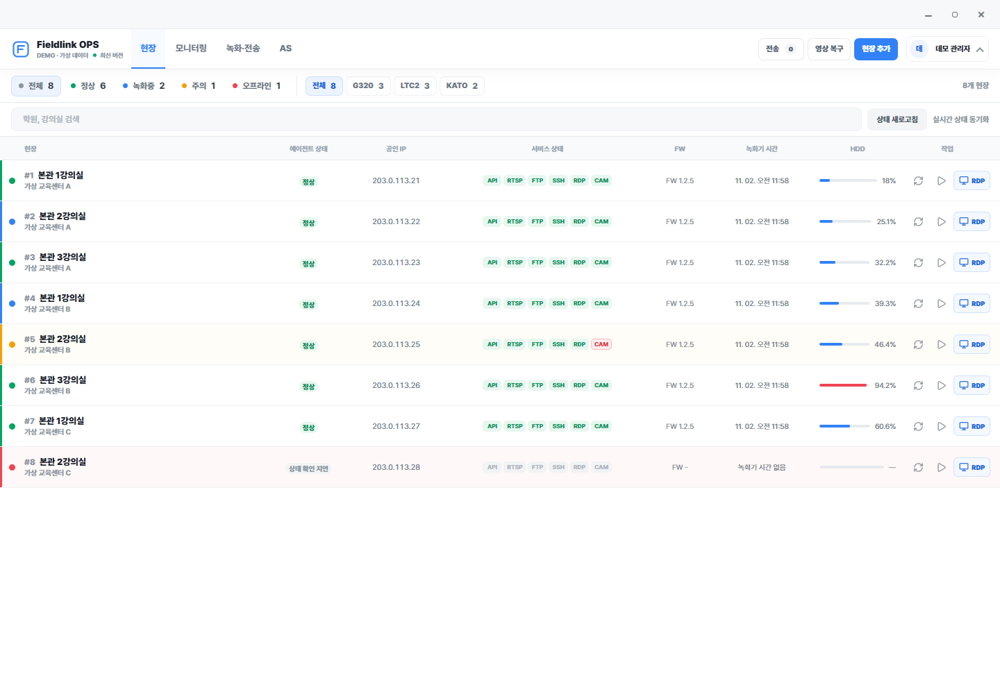
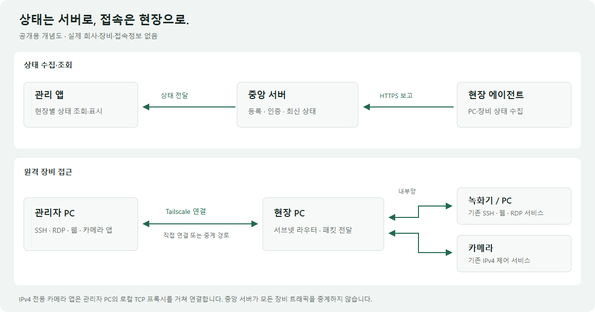
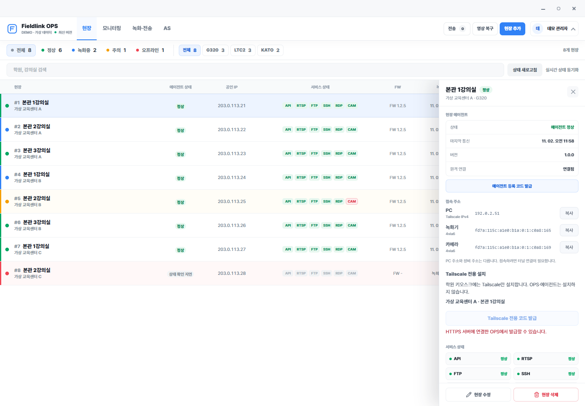
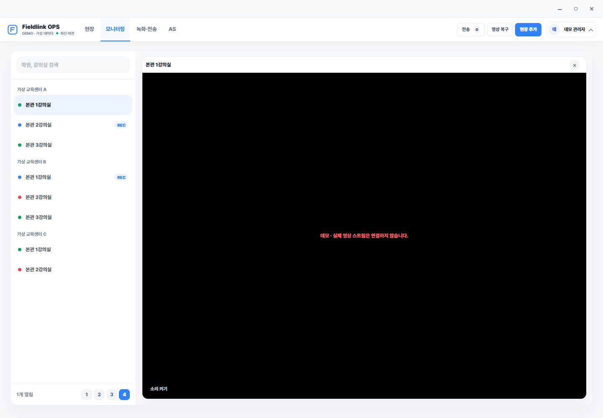
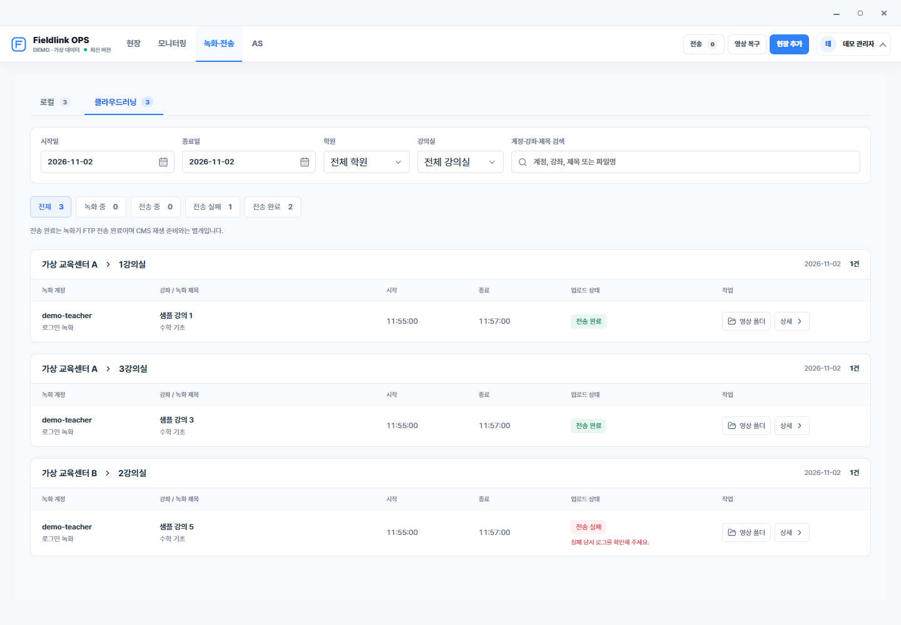

# Remote Field Operations

**Tailscale과 현장 에이전트를 결합한 원격 장비 모니터링·관리 시스템**

현장마다 다른 공유기와 네트워크 환경에서도 PC·녹화기·카메라의 상태를 확인하고 필요한 관리 도구에 접근할 수 있도록 만든 프로젝트입니다. 기존 녹화 시스템을 교체하지 않고, 그 위에 **연결·상태 수집·통합 관리 계층**을 추가했습니다.



> 기존 관리 프로그램의 UI 코드와 스타일을 유지하고, 회사 식별정보와 운영 데이터를 가상 정보로 교체한 데모입니다. 서버·에이전트의 핵심 소스도 포함하지만, 실제 접속정보·인증정보·고객 자료는 포함하지 않습니다.

## 왜 만들었나요?

기존 현장 관리에서는 장비 문제를 확인하기 전에 **접속 경로부터 다시 점검해야 하는 상황**이 있었습니다.

- 공인 IP나 공유기가 바뀌면 기존 포트포워딩 접속이 끊길 수 있었습니다.
- 여러 현장이 같은 내부 IP 대역을 사용해, IP만으로는 어느 현장의 장비인지 구분하기 어려웠습니다.
- PC 원격 접속, 녹화기 확인, 파일 관리, 카메라 제어가 서로 다른 도구에 나뉘어 있었습니다.
- 상태를 확인하기 위해 현장 PC에 먼저 원격 데스크톱으로 들어가는 절차가 필요했습니다.

그래서 **현장을 찾고 → 상태를 확인하고 → 필요한 장비 관리로 이어지는 흐름**을 한곳에 모으는 것을 목표로 했습니다.

## 무엇을 조사했고, 어떻게 적용했나요?

네트워크 용어를 그대로 붙이는 대신, 현장에서 막히는 지점에 맞춰 기술을 조사하고 연결했습니다.

| 해결할 문제 | 조사·검토한 기술 | 시스템에 접목한 방법 |
| --- | --- | --- |
| 공인 IP·공유기 설정에 의존하는 접속 | Tailscale의 장비 간 연결과 인증, 직접 연결·중계 구조 | 관리 PC와 현장 PC 사이에 Tailscale 기반 접근 통로 구성 |
| 녹화기·카메라에 직접 설치하기 어려움 | 서브넷 라우터 | 현장 PC를 경유해 기존 내부 장비의 SSH·웹·제어 서비스에 접근 |
| 여러 현장의 내부 IP가 겹침 | 4via6와 현장 식별값 | 현장과 장비 주소를 함께 구분하는 경로를 구성 |
| 기존 카메라 앱이 IPv6를 받지 못함 | IPv4/IPv6 소켓, TCP 프록시 | 관리자 PC의 루프백 IPv4·임시 포트에서 연결을 받아 4via6 목적지로 중계 |
| 현장마다 로그인·설치 절차가 번거로움 | OAuth, Auth key, 장비 태그 | 서버에서 단기 일회용 인증키를 발급하는 자동 등록 흐름 구현 |
| 여러 도구를 오가며 상태를 확인함 | Windows 서비스, HTTPS 상태 보고, 관리 UI | 에이전트·중앙 서버·관리 데스크톱으로 역할을 분리해 통합 |

관련 기반 기능: [Tailscale 서브넷 라우터](https://tailscale.com/docs/features/subnet-routers), [4via6](https://tailscale.com/docs/features/subnet-routers/4via6-subnets), [OAuth와 인증키 발급](https://tailscale.com/docs/features/oauth-clients).

## 기존 시스템에는 어떻게 붙였나요?

기존 녹화 프로그램과 장비 서비스는 유지했습니다. 현장 PC에 상태를 보고하는 에이전트를 추가하고, 중앙 서버와 별도 관리 데스크톱을 연결했습니다.



| 구성 | 맡은 역할 |
| --- | --- |
| 현장 에이전트 | PC에서 서비스로 실행되어 상태를 수집하고 중앙 서버에 보고 |
| 중앙 서버 | 현장 등록·인증·상태 관리와 관리 앱 연결 |
| 관리 데스크톱 | 여러 현장 모니터링, SSH·RDP·파일·카메라 관리 도구 연계 |
| Tailscale·서브넷 라우터 | 관리 PC에서 해당 현장 내부 장비로 가는 연결 경로 제공 |

**상태 보고와 원격 접속은 별도 경로입니다.** 에이전트의 상태는 중앙 서버로 모으지만, 모든 SSH·RDP 트래픽이 중앙 서버를 반드시 거치는 것은 아닙니다. 현장 PC는 내부 장비로 패킷을 전달하는 역할을 합니다.

## 어떤 기능을 구현했나요?

- **현장 통합 모니터링:** 에이전트 연결 상태, 최근 보고 시각, 장비 서비스 상태를 현장별로 확인.
- **원격 관리 진입점 통합:** 선택한 현장의 SSH·RDP·녹화기 웹 화면으로 연결.
- **PC·녹화기 파일 관리:** 파일 탐색·전송·삭제 작업을 관리 흐름에 통합.
- **카메라 제어 연계:** 기존 제어 프로그램과 연결하고, IPv4 전용 앱에는 로컬 TCP 프록시 적용.
- **현장 등록 자동화:** 단기 등록 코드, 서버 측 인증키 발급, 장비 태그·경로 구성 연계.
- **업데이트와 실패 대응:** 배포 파일 검증, 기존 버전 보관, 성공 확인·복구 흐름 구성.

녹화 상태에서의 조작, 파일 삭제, 업데이트처럼 영향이 큰 작업은 연결 성공 여부와 별도로 다뤄야 합니다. 장비 인증·접근 정책·서브넷 경로 승인도 각각 구분했습니다.

<details>
<summary>기존 UI로 구성한 데모 화면 더 보기</summary>

장비 상세



모니터링 탭 — 실제 영상 스트림은 연결하지 않습니다.



녹화·전송 이력



</details>

## 적용 후 무엇이 달라졌나요?

| 기존 관리 방식 | 프로젝트 적용 후 확인한 변화 |
| --- | --- |
| 공인 IP·포트포워딩 설정을 바탕으로 접속 대상 확인 | Tailscale 장비 식별과 현장별 경로로 접근하도록 구성해 해당 설정에 대한 의존을 줄임 |
| 같은 내부 IP를 쓰는 현장의 대상을 수동 구분 | 4via6 경로에 현장 식별값을 포함해 현장별 장비를 구분 |
| 상태 확인을 위해 현장 PC에 들어가 여러 도구를 실행 | 관리 화면에서 여러 현장의 상태를 먼저 확인하고 필요한 작업으로 이동 |
| IPv6를 받지 못하는 카메라 앱은 현장 PC에서 실행 | 로컬 프록시를 적용해 관리자 PC의 기존 카메라 앱으로 접근하는 경로를 시험·확인 |
| 현장 설치 시 관리 계정으로 로그인하는 절차 필요 | 서버가 발급한 일회용 인증키를 활용하는 등록 절차로 구성 |

실제 PC·녹화기·카메라를 연결해 동작을 시험하고, 나타난 오류와 제약을 설치·등록·접속 흐름에 반영했습니다. **접속 방식과 관리 절차의 변화는 설명하되, 장애율·대응 시간·비용 절감률처럼 별도로 측정하지 않은 수치는 제시하지 않습니다.**

정상 접속에는 인터넷, 현장 PC 동작, 경로 승인, 접근 정책, 대상 장비 서비스가 모두 필요합니다. 인터넷 연결만으로 모든 현장에 항상 접속된다는 보장은 아닙니다.

## AI는 개발에 어떻게 활용했나요?

AI 코딩 도구를 서버·에이전트·UI 구현과 오류 분석, 테스트·문서화에 활용했습니다. 현장 요구사항과 실제 오류를 바탕으로 구현안을 검토하고, 장비에서 시험한 결과를 다시 설계에 반영하는 방식으로 진행했습니다.

Tailscale이나 제조사 제어 프로그램 자체를 개발한 프로젝트는 아닙니다. 기반 기술을 조사하고 기존 장비 환경에 맞게 조합한 **통합 관리 프로토타입**이며, 이후 별도 개발팀이 재구현한 웹 제품은 이 저장소의 구현 범위에 포함하지 않습니다.

## 기술 구성

| 영역 | 사용 기술 |
| --- | --- |
| 관리 데스크톱 | Electron · React · TypeScript |
| 현장 에이전트 | C# · .NET Windows 서비스 |
| 중앙 서버 | Node.js · Express · PostgreSQL |
| 장비 연결 | Tailscale · 4via6 · SSH · RDP · FTP · TCP 프록시 |

## 이 저장소에서 볼 수 있는 것

이 저장소는 **기존 UI를 사용하는 데모와 서버·에이전트 구조를 읽고 실행해 볼 수 있는 공개 소스 예제**를 제공합니다. 화면 구성과 조작 흐름은 유지하면서, 기본 실행에서는 브라우저 안의 합성 데이터만 사용합니다.

| 폴더 | 포함한 코드 |
| --- | --- |
| `apps/desktop/src` | 기존 React 화면·스타일·검색·필터·상세·파일 탐색·녹화 이력 UI와 데모용 연동 |
| `apps/desktop/implementation` | 기존 IPv4 전용 카메라 앱을 위한 루프백 TCP 프록시 구현 |
| `apps/server/src` | UI와 계약을 공유하는 메모리 저장소·로컬 데모 HTTP 서버 |
| `apps/server/implementation` | 기존 서버의 OAuth 일회용 키 발급, 상태 갱신 명령, 측정 유효기간, 입력 검증·네트워크 진단 핵심 코드 |
| `apps/agent` | 가상 상태를 보내는 .NET 실행부와 기존 에이전트의 상태 모델·재시도·로그 증분 읽기 코드 |
| `packages/shared/src` | UI·서버 공통 타입, 4via6 주소 계산, 파일 삭제 범위 검증 구현 |

### 실행

Node.js 22.12 이상에서 저장소 루트의 다음 명령으로 UI를 실행합니다. 장비·Tailscale 계정·인증키·DB는 필요하지 않습니다.

```sh
npm install
npm run dev
```

브라우저에서 `http://127.0.0.1:5173`을 엽니다. 검색·필터·상세, 모니터링 탭, 녹화·전송 이력, PC·녹화기 가상 파일 목록을 확인할 수 있습니다. SSH·RDP·삭제·키 발급·업데이트 버튼은 데모 안내를 표시하며 실제 작업을 수행하지 않습니다. UI는 기존 데스크톱 구성을 유지해 넓은 화면에서 사용하기에 적합합니다.

### 서버와 에이전트도 연결해 보기

별도 터미널에서 아래 두 명령을 각각 실행합니다. 에이전트는 .NET 10 SDK가 필요합니다.

```sh
npm run demo:server
npm run demo:agent
```

UI를 `http://127.0.0.1:5173/?transport=server`로 열면 **가상 에이전트 → 로컬 서버 → 기존 관리 화면**의 흐름을 확인할 수 있습니다. 가상 현장 1의 녹화 상태와 HDD 사용량 42.5%가 반영됩니다. 서버는 `127.0.0.1:4177`에만 열리고 상태는 메모리에만 보관합니다. 운영 HTTPS·DB·인증 체계를 대신하는 배포용 서버가 아닙니다.

데모의 상태 갱신은 조회 방식이고, 원래 제품의 Socket.IO·장기 명령 대기 구조와는 다릅니다. 원본 핵심 구현은 `implementation`에서 확인할 수 있지만 데모 시작 시 자동 실행되지 않습니다.

- [시스템 구조 상세](docs/architecture.md)
- [문제 해결 사례와 제약](docs/engineering-notes.md)
- [개발·검증 과정](docs/ai-collaboration.md)
- [소스 안내와 실행 범위](docs/source-guide.md)
- [공개용 데모 검증](VERIFICATION.md)
- [공개 범위 점검표](docs/publication-checklist.md) · [자료 이용 범위](NOTICE.md)

운영 설정·설치 파일·SDK·실제 고객 데이터·접속정보·원본 Git 이력은 포함하지 않았습니다. 소스별 출처와 변경 범위는 `SOURCE-MAP.json`에 기재했습니다. 외부 공개 전 조직의 소스·화면 공개 기준을 별도로 확인해야 합니다.
